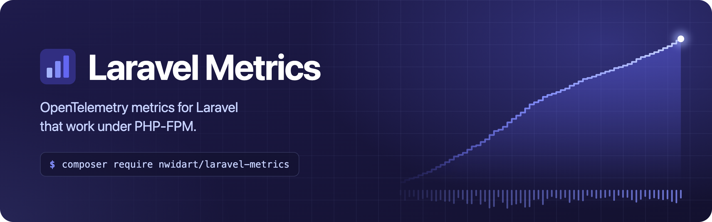

[](https://github.com/nWidart/laravel-metrics/actions/workflows/ci.yml)
[](https://packagist.org/packages/nwidart/laravel-metrics)
[](LICENSE.md)

OpenTelemetry metrics for Laravel that work under PHP-FPM.

The package records HTTP requests, queries, transactions, Eloquent models, queue jobs, cache operations, scheduled tasks and exceptions with no code. Each request records in memory and merges into Redis after the response. Serve the metrics to Prometheus, or push them over OTLP.

**Read the documentation: https://nwidart.github.io/laravel-metrics/**

## Installation

```bash
composer require nwidart/laravel-metrics
```

The service provider registers itself, and recording starts at once. You need PHP 8.2 or later, Laravel 12 or 13, and Redis in production. See [Installation](https://nwidart.github.io/laravel-metrics/installation/) for production settings and the OTLP setup.

## Quick demo

Keep the metrics in the cache instead of Redis, and turn on the Prometheus route, in `.env`:

```dotenv
METRICS_STORE=cache
METRICS_CACHE_STORE=file
METRICS_PROMETHEUS=true
```

Record a metric of your own:

```php
use Nwidart\Metrics\Facades\Metrics;

Route::get('/orders/place', function () {
    Metrics::meter()->createCounter('orders.placed', '{order}')->add(1, ['channel' => 'web']);

    return 'Order placed.';
});
```

Call the route, then read the metrics:

```bash
curl -s http://127.0.0.1:8000/orders/place
curl -s http://127.0.0.1:8000/metrics | grep -E '^(orders_placed_total|http_server_request_duration_seconds_count)'
```

```text
http_server_request_duration_seconds_count{http_request_method="GET",http_response_status_code="200",http_route="/orders/place",network_protocol_version="1.1",otel_scope_name="nwidart/laravel-metrics",url_scheme="http"} 1
orders_placed_total{channel="web",otel_scope_name="app"} 1
```

In production, protect `GET /metrics`. The [tutorial](https://nwidart.github.io/laravel-metrics/tutorials/first-metrics/) goes through these steps and adds a test.

## Development

Requirements: PHP 8.2 or later, Composer, and a Redis server for the tests.

```bash
composer install
docker run -d --name laravel-metrics-redis -p 6379:6379 redis:7.4-alpine
composer test
composer lint
composer analyse
```

The tests use Redis database 15. Set `REDIS_HOST` and `REDIS_PORT` to use another server.

## Changelog

See [CHANGELOG.md](CHANGELOG.md).

## License

MIT. See [LICENSE.md](LICENSE.md).
